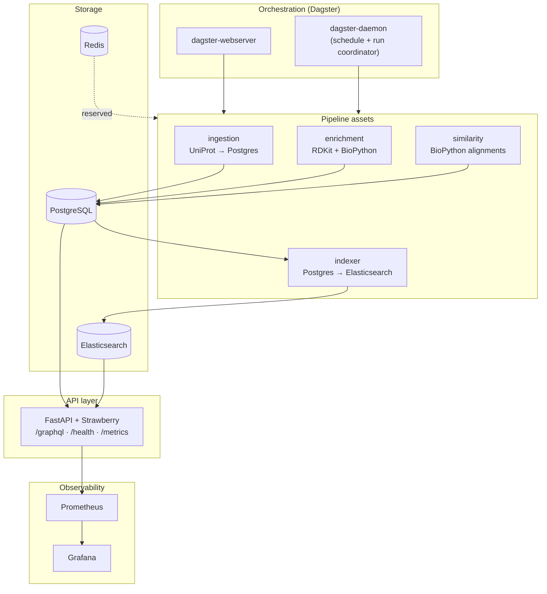

# VenomFlow

**VenomFlow** is an experimental data platform for venom peptide research. It ingests peptide records from UniProt with Dagster, computes physicochemical properties with RDKit/BioPython, pre-computes sequence similarities, indexes the results in Elasticsearch, and exposes them through a Strawberry GraphQL API.

It is a working prototype built to explore a realistic multi-service data stack — not a production system.

---

## Project Status

| Area | Status | Evidence |
|------|--------|----------|
| UniProt ingestion asset | Works | `dagster_pipelines/assets/ingestion.py`, pagination + rate-limit backoff |
| Property enrichment | Works | `dagster_pipelines/assets/enrichment.py`, RDKit + BioPython |
| Sequence similarity | Works (pre-computed, stored in Postgres) | `dagster_pipelines/assets/blast_similarity.py` |
| Elasticsearch indexing | Works | `dagster_pipelines/assets/elasticsearch_indexer.py` |
| GraphQL API (queries) | Works | `api/schema/queries.py`; unit tests in `tests/api/` |
| Daily schedule | Works | `venom_flow_daily_schedule` in `dagster_pipelines/jobs/__init__.py` |
| Prometheus + Grafana | Metrics and a provisioned overview dashboard | `monitoring/` |
| GraphQL mutations / subscriptions | **Not implemented** | Query-only schema |
| Data-validation asset | **Not implemented** | Validation is model-level (Pydantic) only |
| Authentication / JWT | **Not implemented** | API is unauthenticated |
| Alerting | **Not implemented** | Prometheus/Grafana are dashboard-only |

---

## Table of Contents

- [Project Status](#project-status)
- [Overview](#overview)
- [Key Features](#key-features)
- [Use Cases](#use-cases)
- [Quick Start](#quick-start)
- [Architecture](#architecture)
- [Project Structure](#project-structure)
- [Configuration](#configuration)
- [API Documentation](#api-documentation)
- [Data Pipeline](#data-pipeline)
- [Monitoring & Observability](#monitoring--observability)
- [Testing](#testing)
- [Deployment](#deployment)

---

## Overview

VenomFlow is designed for collecting, processing, and analyzing venom peptide data from UniProt. The platform leverages data engineering practices and tools to provide a scalable, maintainable, and extensible solution for venom research.

### Why VenomFlow?

- **Orchestrated Pipelines**: Asset-based ingestion, enrichment and indexing with Dagster, plus a daily schedule
- **Service Separation**: Independent Compose services for database, cache, search, orchestration and API
- **Search**: Full-text peptide search backed by Elasticsearch
- **GraphQL API**: Query-only FastAPI + Strawberry endpoint with a GraphiQL playground
- **Observability**: Prometheus metrics and a provisioned Grafana overview dashboard
- **Validated Models**: Pydantic models enforce sequence, quality-score and field constraints

---

## Key Features

### Data Ingestion & Processing
- **UniProt Integration**: Fetch data from UniProt with rate limiting and pagination
- **Model Validation**: Pydantic models reject invalid amino-acid codes and out-of-range quality scores
- **Sequence Similarity**: Pre-computed Smith-Waterman/BioPython alignments stored in PostgreSQL
- **Property Enrichment**: Physicochemical properties computed with RDKit and BioPython
- **Batch Processing**: Chunked bulk inserts and batched enrichment

### Search & Discovery
- **Full-text Search**: Elasticsearch-backed search over name, UniProt ID, family and sequence
- **Advanced Filtering**: Filter by organism, family, venom type, sequence length, mass and more
- **Similarity Lookup**: Retrieve pre-computed similar peptides above a score threshold

### API & Integration
- **GraphQL API**: Query-only schema for peptides, organisms, properties and similarities
- **Health and Metrics Endpoints**: `/health` and `/metrics` on the FastAPI service
- **Interactive Playground**: GraphiQL at `/graphql`, OpenAPI docs at `/docs`

### Monitoring & Analytics
- **Prometheus Metrics**: Request rate, latency percentiles and in-flight requests
- **Grafana Dashboard**: Pre-provisioned *VenomFlow Overview* dashboard
- **Structured Logs**: JSON logs from the API and Dagster services

---

## Use Cases

### Drug Discovery
- Identify novel peptides with specific bioactivities
- Screen potential therapeutic candidates
- Analyze structure-activity relationships

### Comparative Biology
- Study venom peptide evolution across species
- Identify conserved sequences and motifs
- Map bioactivity distribution across taxa

### Toxinology Research
- Catalog venom components from diverse organisms
- Track toxin variants and isoforms
- Link peptides to clinical effects

### Chemical Biology
- Analyze physicochemical properties
- Predict peptide stability and solubility
- Design peptide modifications

---

## Quick Start

Get VenomFlow running locally in under 5 minutes!

### Prerequisites

- **Docker** 24.0+ and **Docker Compose** v2.0+
- **Git** for cloning the repository
- At least **8GB RAM** and **20GB disk space**

### Installation

1. **Clone the repository**
   ```bash
   git clone https://github.com/Gasta88/venomflow.git
   cd venomflow
   ```

2. **Configure environment variables**
   ```bash
   cp .env.example .env
   # Edit .env with your preferred settings (optional for quick start)
   nano .env
   ```

3. **Start all services**
   ```bash
   make up
   ```

4. **Wait for services to be healthy** (30-60 seconds)
   ```bash
   make ps
   ```

5. **Access the services**
   - **Dagster UI**: http://localhost:3000
   - **GraphQL API / Playground**: http://localhost:8000/graphql
   - **API health**: http://localhost:8000/health
   - **Grafana**: http://localhost:3001
   - **Prometheus**: http://localhost:9090
   - **Elasticsearch**: http://localhost:9200
   - **PostgreSQL**: localhost:5432

### Verify Installation

```bash
# Check all services are running
make ps

# View all logs
make logs

# API health check
curl http://localhost:8000/health

# Minimal GraphQL smoke test
curl -X POST http://localhost:8000/graphql \
  -H "Content-Type: application/json" \
  -d '{"query": "{ __typename }"}'
```

### Stop Services

```bash
# Stop all services
make down

# Stop and remove volumes (WARNING: deletes all data)
make clean
```

---

## Architecture



The pipeline runs as one asset job (`venom_flow_pipeline`) and is attached to a
daily schedule (`venom_flow_daily_schedule`, 02:00 UTC).

### Architecture Principles

1. **Separation of Concerns**: Each service has a single, defined responsibility
2. **Loose Coupling**: Services communicate through the database and HTTP interfaces
3. **Asset-Based Orchestration**: Dagster models each pipeline step as a data asset
4. **Observability**: Structured logs plus Prometheus/Grafana metrics
5. **Explicit Scope**: Unimplemented areas are listed in [Project Status](#project-status)

---

## Project Structure

```
venomflow/
├── README.md
├── LICENSE
├── pyproject.toml                   # Metadata, dependency extras, pytest/ruff/coverage config
├── requirements-dev.txt             # Dev/test tooling
├── requirements-dev.lock            # Hash-pinned lockfile for CI and local development
├── docker-compose.yml               # 8-service local stack
├── Makefile
├── .env.example
│
├── api/                             # FastAPI + Strawberry GraphQL
│   ├── Dockerfile
│   ├── .dockerignore
│   ├── requirements.txt
│   ├── requirements.lock
│   ├── main.py                      # App factory, /health, /metrics, /graphql
│   └── schema/
│       ├── __init__.py
│       ├── queries.py               # Query resolvers
│       └── types.py                 # Strawberry types and input filters
│
├── dagster_pipelines/               # Dagster orchestration
│   ├── Dockerfile
│   ├── .dockerignore
│   ├── requirements.txt
│   ├── requirements.lock
│   ├── dagster.yaml
│   ├── dagster_simple.yaml
│   ├── workspace.yaml
│   ├── __init__.py                  # Definitions entry point
│   ├── assets/
│   │   ├── __init__.py
│   │   ├── ingestion.py             # UniProt ingestion
│   │   ├── enrichment.py            # Property enrichment asset
│   │   ├── property_calculators.py  # RDKit/BioPython helpers
│   │   ├── blast_similarity.py      # Sequence similarity asset
│   │   └── elasticsearch_indexer.py # Bulk indexing asset
│   ├── jobs/
│   │   └── __init__.py              # venom_flow_pipeline + daily schedule
│   └── resources/
│       ├── __init__.py
│       ├── database.py
│       ├── elasticsearch.py
│       └── redis.py
│
├── shared/                          # Code shared by API and pipelines
│   ├── config/
│   │   └── settings.py              # Pydantic settings
│   ├── models/
│   │   ├── organism.py
│   │   ├── peptide.py
│   │   ├── bioactivity.py
│   │   └── properties.py
│   └── database/
│       ├── connection.py
│       ├── 01-schema.sql            # PostgreSQL schema
│       └── 02-dagster-init.sql      # Dagster metadata database
│
├── scripts/
│   ├── init_database.sh
│   ├── verify_infrastructure.py
│   ├── verify_schema.py
│   ├── analyze_schema.py
│   └── test_database.py
│
├── monitoring/
│   ├── prometheus/
│   │   └── prometheus.yml
│   └── grafana/
│       ├── dashboards/
│       └── datasources/
│
├── tests/
│   ├── conftest.py
│   ├── api/                         # GraphQL type and resolver tests
│   └── unit/                        # Asset, resource, settings and model tests
│
└── .github/
    └── workflows/
        └── ci.yml                   # Ruff, pytest, docker compose config
```

---

## Configuration

VenomFlow uses environment variables for configuration. Copy `.env.example` to `.env` and customize:

### Critical Settings

```bash
# Application
APP_ENV=development          # development, staging, production
APP_DEBUG=true               # Enable debug mode

# Database
POSTGRES_HOST=postgres
POSTGRES_PORT=5432
POSTGRES_DB=venomflow
POSTGRES_USER=venomflow_user
POSTGRES_PASSWORD=your_secure_password_here

# Cache
REDIS_HOST=redis
REDIS_PORT=6379
REDIS_PASSWORD=your_redis_password_here

# Search
ELASTIC_HOST=elasticsearch
ELASTIC_PORT=9200
ELASTIC_PASSWORD=your_elastic_password_here

# API
API_PORT=8000
API_SECRET_KEY=your_32_character_secret_key_here
```

---

## API Documentation

### GraphQL Playground

Access the interactive GraphQL playground at http://localhost:8000/graphql

### Example Queries

**Get peptides with pagination**
```graphql
query GetPeptides {
  searchPeptides(page: 1, pageSize: 10) {
    items {
      id
      sequence
      name
      organism {
        name
        taxonomyId
      }
      bioactivities {
        activityType
        value
      }
    }
    pageInfo {
      total
      page
      pageSize
      totalPages
      hasNext
      hasPrevious
    }
  }
}
```

**Search peptides**
```graphql
query SearchPeptides {
  searchPeptides(query: "neurotoxin", page: 1, pageSize: 5) {
    items {
      id
      sequence
      name
      qualityScore
    }
    pageInfo {
      total
      page
    }
  }
}
```

**Get peptide by UniProt accession**
```graphql
query GetPeptide {
  peptide(accession: "P00974") {
    id
    uniprotId
    name
    sequence
    organism {
      name
      venomType
    }
    properties {
      isoelectricPoint
      hydrophobicity
    }
  }
}
```

**Find similar peptides**
```graphql
query SimilarPeptides {
  similarPeptides(accession: "P00974", threshold: 0.7, limit: 10) {
    queryAccession
    threshold
    items {
      peptide {
        id
        name
        sequence
      }
      similarityScore
      alignmentMethod
    }
    total
  }
}
```

---

## Data Pipeline

### Pipeline Architecture

VenomFlow uses Dagster for orchestrating data pipelines with the following stages:

1. **Ingestion**: Fetch venom peptide records from UniProt into PostgreSQL
2. **Enrichment**: Compute physicochemical properties with RDKit/BioPython
3. **Similarity**: Pre-compute sequence alignments and store them in PostgreSQL
4. **Indexing**: Bulk-index enriched peptides into Elasticsearch

There is no separate validation asset; records are validated by the Pydantic
models and constrained by the PostgreSQL schema on write.

### Running Pipelines

```bash
# Via Dagster UI
# Navigate to http://localhost:3000 and click "Launchpad"

# Via CLI (from inside the Dagster container)
dagster job execute -m dagster_pipelines -j venom_flow_pipeline

# Scheduled execution
# venom_flow_daily_schedule runs the job every day at 02:00 UTC.
# Enable it in the Dagster UI (Overview -> Schedules) or start the daemon.
```

### Pipeline Monitoring

- **Runs**: Watch pipeline execution in the Dagster UI
- **Metrics**: View API throughput and latency in Grafana
- **Logs**: Access detailed logs in Dagster or via `make logs-<service>`

---

## Monitoring & Observability

VenomFlow ships with a fully provisioned **Prometheus + Grafana** monitoring stack.
When you run `make up`, both services start automatically, the Prometheus datasource
is registered in Grafana, and the *VenomFlow Overview* dashboard is loaded — no
manual configuration needed.

### Architecture

```
FastAPI (/metrics)  ──▶  Prometheus (scrape)  ──▶  Grafana (visualise)
```

- **Prometheus** scrapes the FastAPI `/metrics` endpoint every 15 s and stores the
  time-series data.
- **Grafana** reads from Prometheus through a pre-provisioned datasource and displays
  the *VenomFlow Overview* dashboard.

### Accessing the Services

| Service    | URL                        | Credentials                                       |
|------------|----------------------------|----------------------------------------------------|
| Grafana    | http://localhost:3001      | `admin` / value of `GRAFANA_ADMIN_PASSWORD` in `.env` |
| Prometheus | http://localhost:9090      | No authentication                                  |

### Grafana Setup & Dashboard

Grafana is **auto-provisioned** on first start via configuration files mounted into the
container:

| File | Purpose |
|------|---------|
| `monitoring/grafana/datasources/datasource.yml` | Registers Prometheus as the default datasource |
| `monitoring/grafana/dashboards/dashboards.yml` | Tells Grafana where to find dashboard JSON files |
| `monitoring/grafana/dashboards/venomflow-overview.json` | The *VenomFlow Overview* dashboard |

**To inspect the dashboard:**

1. Start all services: `make up`
2. Open Grafana at http://localhost:3001
3. Log in with `admin` / your `GRAFANA_ADMIN_PASSWORD`
4. Navigate to **Dashboards → VenomFlow Overview**

The dashboard contains the following panels:

| Panel | Description |
|-------|-------------|
| API Status | `up` / `down` indicator for the FastAPI service |
| Prometheus Status | `up` / `down` indicator for Prometheus self-monitoring |
| API Request Rate | Requests per second broken down by method, handler, and status |
| API Response Latency | p50 / p95 / p99 response time percentiles |
| HTTP Responses by Status Code | Rate of 2xx, 4xx, 5xx responses |
| Requests In Progress | Number of currently in-flight requests |

### Prometheus Configuration

Prometheus configuration lives at `monitoring/prometheus/prometheus.yml`.
The API scrape target (`api:8000`) is pre-configured; additional exporters
(PostgreSQL, Redis, Elasticsearch) can be enabled by uncommenting or adding
their targets.

### API Metrics Endpoint

The FastAPI application exposes Prometheus-format metrics at
`http://localhost:8000/metrics` using
[`prometheus-fastapi-instrumentator`](https://github.com/trallnag/prometheus-fastapi-instrumentator).
Key metrics include:

- `http_requests_total` — total request count by method, handler, and status
- `http_request_duration_seconds` — request latency histogram
- `http_requests_in_progress` — gauge of in-flight requests

### Logging

Logs are collected in JSON format and available via:

```bash
# All services
make logs

# Specific service
make logs-dagster-webserver

# With grep
make logs | grep ERROR
```

---

## Testing

The project uses **pytest** for unit testing. The suite has **140 tests** covering
the Dagster assets and helpers, resources, job/schedule definitions, shared Pydantic
models, and the GraphQL types and query resolvers. No external services (database,
Elasticsearch, Redis) are needed — clients are mocked or faked.

### Running Tests

```bash
# Install the hash-pinned dev environment
pip install --require-hashes -r requirements-dev.lock

# Run the full suite (no Docker required)
make test

# Run with coverage
make test-cov

# Lint
ruff check .
```

### Test Structure

```
tests/
├── conftest.py
├── api/
│   ├── test_types.py                   # Strawberry schema and type construction
│   └── test_queries.py                 # Row mapping + peptide/similarity resolvers
└── unit/
    ├── assets/
    │   ├── test_blast_similarity.py    # Sequence alignment, helpers, asset
    │   ├── test_elasticsearch_indexer.py
    │   ├── test_enrichment.py          # Property enrichment asset, batch helpers
    │   └── test_ingestion.py           # UniProt ingestion, hashing, batch insert
    ├── test_property_calculators.py    # RDKit/BioPython property computation
    ├── test_resources.py               # Database, Elasticsearch, Redis resources
    ├── test_shared_models.py           # Sequence validation, computed fields, bounds
    ├── test_jobs.py                    # Job and schedule definitions
    └── test_settings.py                # Pydantic settings and validators
```

---

## Deployment

### Self-Hosted Deployment

The Compose stack targets local development and demos. Before exposing it beyond
your machine, review every value in `.env` and put an authenticating proxy in front
of the API — the GraphQL endpoint has no authentication.

```bash
# 1. Set the environment
export APP_ENV=production
export APP_DEBUG=false

# 2. Provide your own values in .env (strong passwords, hosts, secrets)

# 3. Build and start
make build
make up

# 4. Verify
make ps
curl http://localhost:8000/health
```

PostgreSQL applies `shared/database/01-schema.sql` on first initialisation; there is
no separate migration tool.

### Infrastructure Requirements

**Minimum (Development)**
- 4 CPU cores
- 8 GB RAM
- 50 GB disk space

**Recommended (Larger Datasets)**
- 8 CPU cores
- 16 GB RAM
- 200 GB SSD storage
- Load balancer
- Backup storage

